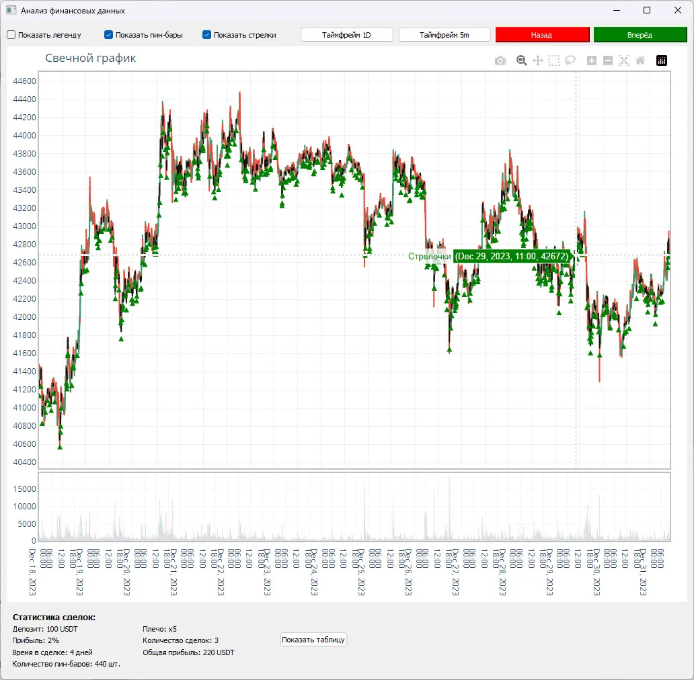

# scalping_bybit_v1

Исследование скальпинга: загрузка свечей, поиск пин-баров, графики и оценка результатов стратегии.

**Python-портфолио Евгения Толмачева** · Начало: 2023 · Python · PyQt · pandas · Plotly



## Возможности

- Получение свечных данных Bybit.
- Поиск пин-баров и визуальная проверка сигналов.
- Расчёт результатов и подбор параметров стратегии.

## Что смотреть в коде

Поиск пин-баров, работа с историческими свечами и отображение результатов в PyQt/Plotly.

Начните с `scalping_bybit_v1.py`. Названия авторских файлов и их расположение сохранены.

## Структура

```text
scalping_bybit_v1/
├── docs/
│   └── preview.webp
├── .gitignore
├── README.md
├── README.public.md
├── requirements.txt
└── scalping_bybit_v1.py
```

## Подготовка и запуск

Это сохранённая версия пет-проекта, показывающая этап развития навыков. Для воспроизведения создайте отдельное окружение Python, совместимое с зафиксированными зависимостями:

```powershell
python -m venv .venv
.venv\Scripts\Activate.ps1
python -m pip install -r requirements.txt
```

Нужны dataframe_btc_1d.pkl и dataframe_btc_5m_all.pkl. Это исследовательский проект; расчёт на истории не подтверждает будущую доходность.

После подготовки настроек и необходимых данных основная точка входа:

```powershell
python scalping_bybit_v1.py
```

`requirements.txt` сохранён из проекта. Это снимок окружения, а не гарантия совместимости с новейшей версией Python. Для старых проектов могут потребоваться соответствующая версия Python и настройка системных компонентов.

## История и состав публикации

В таблице - январь 2023 по дате CSS. Основной код относится к декабрю 2023.

В репозитории оставлены авторские исходники, зависимости и один компактный скриншот. Виртуальные окружения, сторонние библиотеки, рабочие базы, модели, большие наборы данных и персональные настройки не включены.

Чувствительные значения заменены понятными заглушками `YOUR_...` / `REDACTED_...`. Настоящие доступы не следует добавлять в Git. Алгоритмы и структура проекта при подготовке публикации не перерабатывались.

Проверена синтаксическая корректность Python-файлов и выполнено сканирование публикуемой копии на секреты. Полный запуск с внешними API, платежами, биржевыми операциями и локальными моделями не выполнялся.

Автор: [Евгений Толмачев](https://github.com/EvgenyET) · [Портфолио](https://evgeny.tech/)
