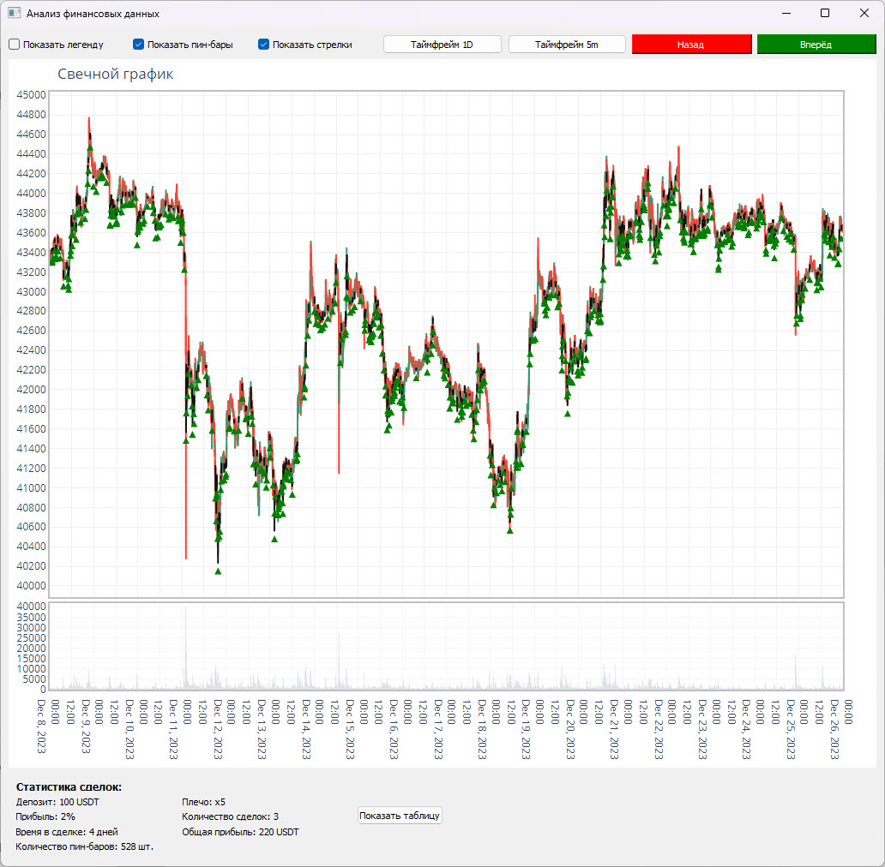
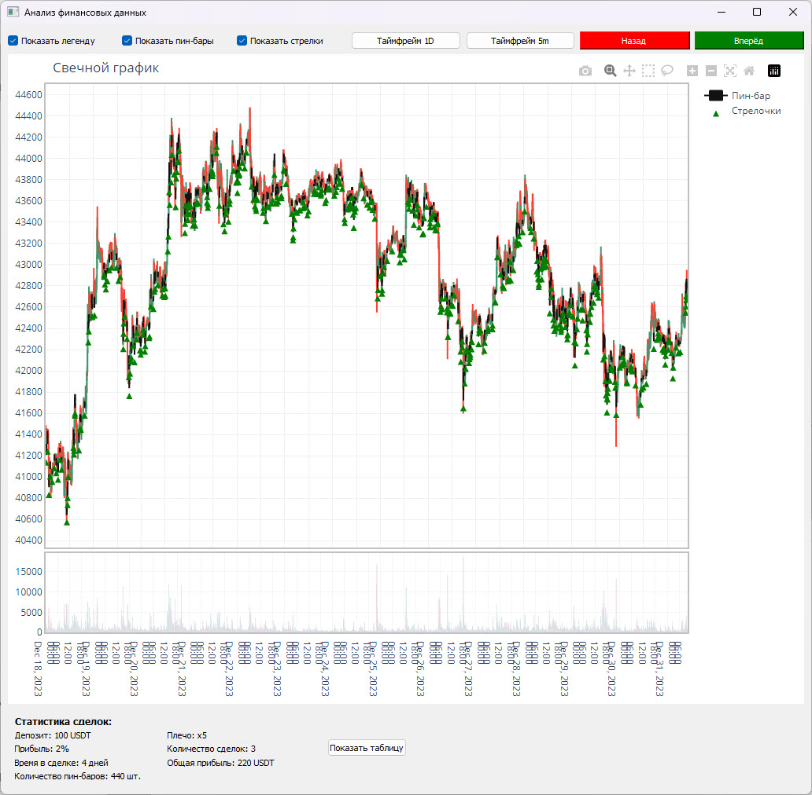
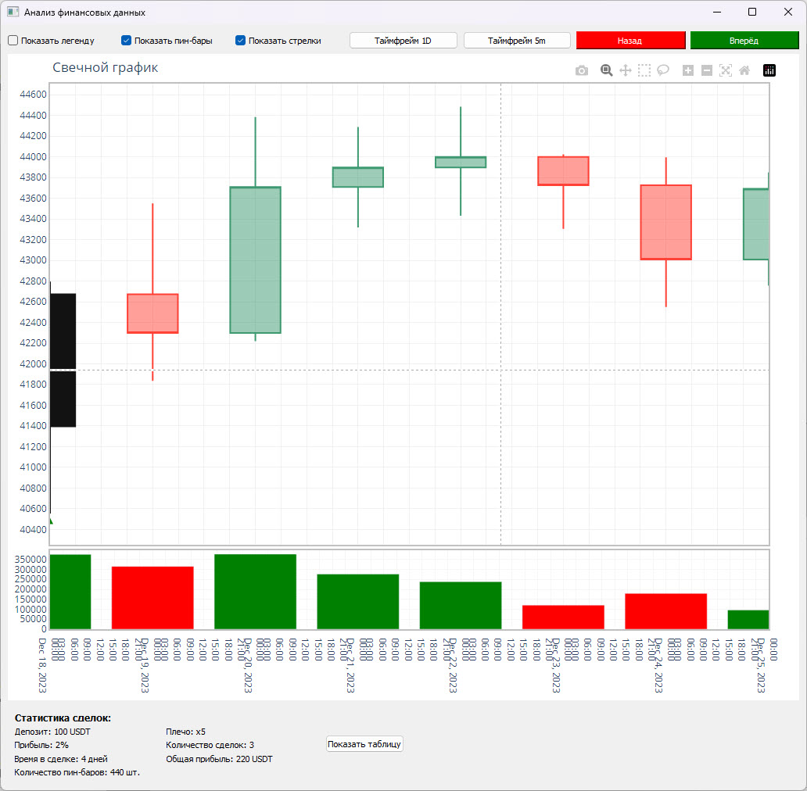
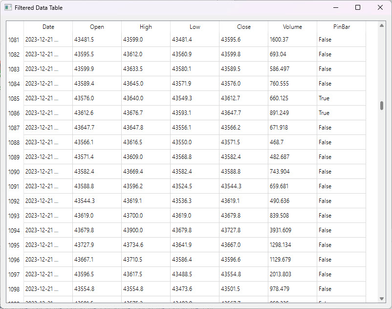
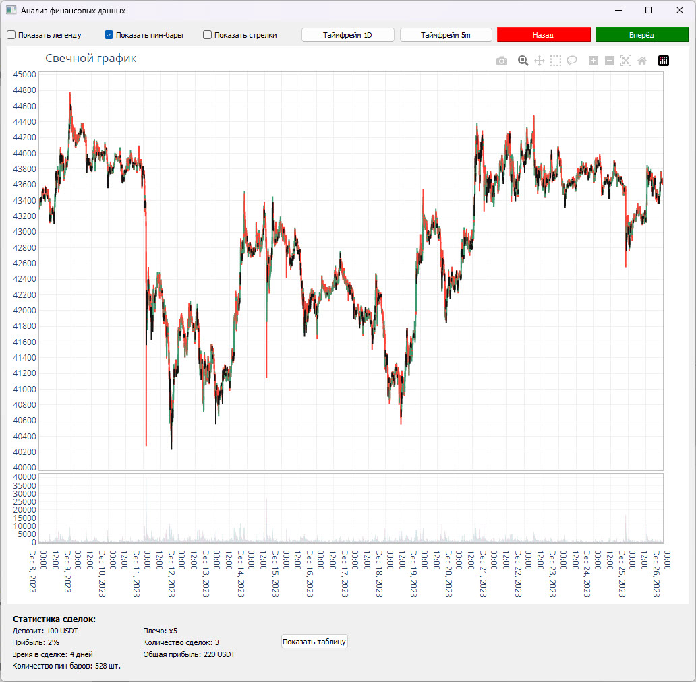

# Анализ свечей и поиск пин-баров

Рабочее название: `scalping_bybit_v1`.

Настольный инструмент для визуального исследования исторических свечей Bitcoin. Пользователь переключает дневные и пятиминутные данные, выбирает диапазон дат и рассматривает пин-бары - свечи с заданным соотношением тела и теней.

**Python-портфолио Евгения Толмачева** · Python · PyQt5 · Qt WebEngine · pandas · Plotly



## Скриншоты

<details>
<summary>Анализ свечей и поиск пин-баров - 5 снимков</summary>

### Скриншот 1


### Скриншот 2



### Скриншот 3



### Скриншот 4



### Скриншот 5



</details>

## Возможности

- Читает сохранённые наборы свечей и фильтрует их по выбранному периоду.
- Определяет пин-бары по форме свечи и подсчитывает их количество.
- Показывает свечи и объёмы на общем графике с переключением маркеров, стрелок и легенды.
- Позволяет перемещаться по истории и открывать таблицу исходных значений.

## Как устроен проект

### Загрузка и фильтрация

[`scalping_bybit_v1.py`](scalping_bybit_v1.py)

load_data и process_and_display_data подготавливают таблицу и выбирают нужный временной интервал.

### Поиск свечных форм

[`scalping_bybit_v1.py`](scalping_bybit_v1.py)

is_pin_bar сравнивает тело и тени свечи. Результат используется для выделения свечей и подсчёта статистики.

### Графический интерфейс

[`scalping_bybit_v1.py`](scalping_bybit_v1.py)

Окно PyQt5 объединяет график Plotly, элементы управления, таблицу и виджет статистики TextWidget.

## Технологии и их роль

- **PyQt5 и Qt WebEngine**: Настольное окно, кнопки, таблица и встроенный просмотр HTML-графика.
- **pandas**: Подготовка дат, фильтрация свечей и расчёт признаков.
- **Plotly**: Свечной график с объёмами и выделением найденных пин-баров.

## С чего начать просмотр кода


В одном файле можно проследить весь путь данных: от load_data через is_pin_bar до create_candlestick_graph и интерфейса PyQt5.

## Подготовка и запуск

Создайте отдельное окружение и установите исходные зависимости:

```powershell
python -m venv .venv
.venv\Scripts\Activate.ps1
python -m pip install -r requirements.txt
```

Нужны dataframe_btc_1d.pkl и dataframe_btc_5m_all.pkl. Панель содержит демонстрационные показатели; основной сценарий - исследование свечей и пин-баров.

После подготовки настроек и необходимых данных основная точка входа:

```powershell
python scalping_bybit_v1.py
```

`requirements.txt` сохранён из проекта. Это снимок окружения, а не гарантия совместимости с новейшей версией Python. Для старых проектов могут потребоваться соответствующая версия Python и настройка системных компонентов.

## Структура

```text
scalping_bybit_v1/
├── docs/
│   ├── preview.webp
│   └── screenshots/  # скриншоты из портфолио
├── .gitignore
├── README.md
├── requirements.txt
└── scalping_bybit_v1.py
```

## Контекст и ограничения

Ранний этап работы над инструментами анализа свечей в 2023 году. В этой версии основное внимание уделено графику и взаимодействию с данными. Панель содержит демонстрационные торговые показатели; из её статистики по данным пересчитывается количество пин-баров.

Проверены синтаксис Python-файлов и состав публикации. Полный запуск этой версии с внешними сервисами, локальными данными или моделями не выполнялся; команды выше описывают подготовку по исходникам.

## Состав репозитория

Сохранены авторские исходники, их имена и структура, зависимости и скриншоты интерфейса. Рабочие базы, наборы данных, модели и виртуальные окружения исключены. Секреты заменены обозначениями `YOUR_...` / `REDACTED_...`; реальные значения задаются локально. Исходные алгоритмы при оформлении портфолио не перерабатывались.

Автор: [Евгений Толмачев](https://github.com/EvgenyET) · [Портфолио](https://evgeny.tech/)
